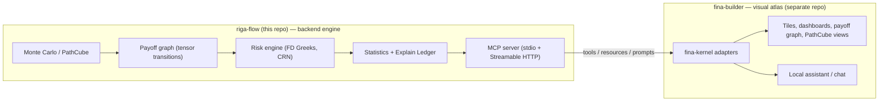
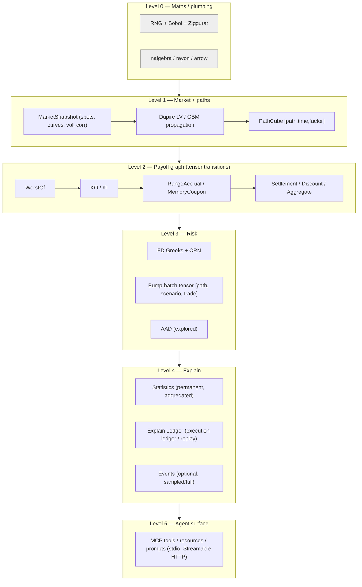

# 01 — System Overview

> **Status:** Descriptive / normative boundary rules.

---

## 1. What riga-flow is

riga-flow is the **backend engine**. It turns a market state plus a book of path-dependent
structured products (starting with Phoenix / Snowball / Athena / KIKO autocallables) into:

1. **Prices** (PV) computed by Monte Carlo,
2. **Risk** (FD Greeks under Common Random Numbers, with an AAD path explored),
3. **Population statistics** over the simulated paths,
4. **A Petri-net execution ledger** that explains how those numbers came to be,
5. **Machine-readable explanations** an LLM (or a human) can traverse.

It is **not** a dashboard. It computes and explains; it does not draw.

## 2. The two-product split



**Boundary rule (normative).**

| Concern | Owner |
| --- | --- |
| Numerical pricing, risk, statistics, explain ledger | **riga-flow** |
| Execution events, Petri-net graph model, replay | **riga-flow** |
| MCP tools/resources/prompts over engines | **riga-flow** |
| Rendering graphs, tiles, charts, notebooks, colours, layout | **fina-builder** |
| Human UX state, persistence, local model chat | **fina-builder** |
| Business glossary wording shown to a trader | shared: riga-flow emits semantics, fina-builder renders copy |

riga-flow **must not** ship a UI. `fina-builder` **must not** re-implement a formula; it
calls riga-flow (today via its own `fina-kernel`; after handoff via riga-flow's MCP/tools or
a linked library). See [`../handoff/42-kernel-contract.md`](../handoff/42-kernel-contract.md).

## 3. Why agent-tool-first, not REST

The primary user of riga-flow is an **agent** (a model-driven investigator, or a validation
automation), not a browser session. This shapes the interface:

- The unit of interaction is a **tool call** with a typed schema, not an HTTP endpoint with
  ad-hoc query params.
- Long-running work (100k-trade books, 61 bump-scenarios) is a **tool with progress and
  cancellation**, not a blocking GET.
- Explanation is a **first-class tool** (`explain_*`), not a separate reporting product.
- Determinism and reproducibility (seed, `as_of`, CRN) are in the request, so an agent can
  replay any answer.

Consequently riga-flow exposes **MCP v2** over **stdio** (local, zero-config, spawned as a
child process) and **Streamable HTTP** (remote/multi-tenant), using the official Rust SDK
`rmcp`. See [`../mcp/30-mcp-server-design.md`](../mcp/30-mcp-server-design.md).

> A thin REST adapter MAY exist for CI smoke tests and non-agent integrations, but it is a
> *secondary* surface over the same dispatcher. The dispatcher, not the transport, owns the
> contract.

## 4. Core thesis

The design converges on one architectural claim, appearing in both the tensor work and the
explainability work:

```
Do NOT make the pricer faster trade-by-trade.
Change the computational model from trade-centric to scenario-centric.
```

| Bad (QuantLib-style) | Good (riga-flow) |
| --- | --- |
| `for trade: simulate; price` | `generate scenarios once → batch trades → batch bumps → batch pricing` |
| MC regenerated 100k times | MC generated once, consumed by many trades |
| Per-trade `NPV()` abstraction | `[path, scenario, trade]` tensors |
| Greek per bump per trade serially | bump batches evaluated together |

The atlas work adds the second half of the thesis: **an execution ledger is what makes the
engine explainable.** A debugger answers "why did this line run?"; a Petri net answers "why
did this trade end up with this risk profile?" — the question model validators actually ask.

## 5. Layered architecture



This mirrors the classic three-level observability hybrid (`Rust tracing` → `Petri-net event
model` → `LLM analyst`), generalised to five engine layers with trace levels folded into
Level 4.

## 6. The explainability thesis

The LLM opportunities are ranked by ROI below. riga-flow's job is to make each of these
*answerable from structured evidence*:

| # | Use case | ROI | Where it is served |
| --- | --- | --- | --- |
| 1 | Risk attribution explanation ("why is today's PV different?") | Extremely high | Explain Ledger + transition attribution |
| 2 | Regression-test exception triage | Extremely high | Statistics + tolerance engine |
| 3 | Validation failure RCA | Extremely high | Event-sourced replay + corpus |
| 4 | Scenario recommendation | High | Barrier-proximity / stress discovery |
| 5 | Interactive PathCube Q&A | High | PathCube query tools |
| 6 | Governance report generation | High | Structured evidence export |
| 7 | Greek intuition checking | Medium | Greek sanity rules + LLM |
| 8 | Direct pricing assistance | Low | **Explicitly not a goal** |

The engine must never let an LLM into the pricing path. The required mapping is:

```
Monte Carlo Engine → Risk Analytics → PathCube → Explain Ledger → LLM Investigator
```

## 7. Non-goals

- LLM-assisted *valuation* ("You don't want an LLM anywhere near the pricing path").
- Being a general-purpose derivatives library (no equity vanilla term sheet support beyond
  what baskets need).
- A trading system, booking system, market-data subscription service, or legal settlement
  processor.
- Owning the visual layer.

## 8. Success in one sentence

A model validator can ask "why did PV fall 1.2 today, and which transition drove it?"
and receive an economically coherent, evidence-linked answer — while the same engine prices
a 100k-trade heterogeneous Phoenix book without a trade-level simulation loop in the
top-level execution flow.
