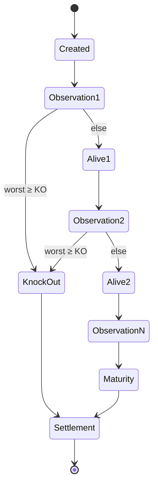

# 02 — Execution Model

> **Status:** Normative (the four-concepts separation and trace levels are load-bearing).

---

## 1. The central correction: four different concepts

The single biggest conceptual mistake to avoid is **mixing tokens,
events, transitions and statistics into one thing**. riga-flow keeps them separate:

| Concept | Definition | Analogy | Mutability | Permanence |
| --- | --- | --- | --- | --- |
| **Token** | The economic state of one MC path at a point in the net | "state" | Mutated by transitions | Runtime-only (unless snapshotted) |
| **Transition** | A payoff-graph / business-rule function | "action" | Immutable logic | Code |
| **Event** | A record that a transition fired, with data | "observation" | Append-only | Optional, sampled or full |
| **Statistics** | Aggregated analytics over a population | "population" | Accumulated | **Permanent, first-class** |

Doctrine:

```
Token      = economic state
Transition = payoff logic
Event      = observation record
Statistics = aggregated analytics
```

Mapping to Phoenix:

```
MC Path      → Token        (Spot history, KO/KI state, coupon state, cashflows)
Business Rule→ Transition   (Autocall check, coupon check, KI check, settlement)
Execution Rec→ Event        (path=13482, obs=5, result=alive)
Population   → Statistics   (input 100000, KO 23111, alive 76889, KO prob 23.1%)
```

**Why it matters.** The naive claim that "events are tokens" is wrong and must be rejected:
A token is *fundamental*: it determines PV, Delta, Vega, Gamma. An event merely *describes*
what happened — it is diagnostic evidence, not an input to the payoff. Statistics, not
events, are what actually build Sankey diagrams, PathCube, attribution and LLM summaries.

### 1.1 Consequence for the Rust design

The production engine must make **Statistics the first-class citizen**, **Tokens the runtime
state**, and **Events merely an optional observability layer**. This separation is what lets
the design scale to tens of millions of Monte Carlo paths.

```rust
/// Runtime economic state of one path. Mutated in place; never allocated per-step.
struct Token {
    path_id: usize,
    worst_of: f64,
    knocked_out: bool,
    knock_in: bool,
    coupon_count: usize,
    payoff: f64,
}

/// Aggregated over the population at every transition. Permanent.
struct TransitionStats {
    transition_id: TransitionId,
    input_count: u64,
    output_count: u64,
    probability: f64,
    mean_payoff: f64,
    variance_payoff: f64,
    mean_delta: f64,
    mean_vega: f64,
}
```

## 2. Petri-net conceptual model

A Phoenix note is naturally a state machine, which is why the Petri view is adopted at
the **design/observability level** (never as the pricing implementation):



- **Places** hold data (`PathCube`, `WorstTensor`, `CouponMask`, `PathPV`).
- **Tokens** are *tensors* in this engine, not individual trade objects (see
  `03-tensor-engine.md`). At the observability level one token is one path; at the engine
  level the token is a whole array of paths processed together.
- **Transitions** are pure: tensor in, tensor out, no hidden state, no trade loops.

```rust
trait Transition {
    fn execute(&self, ctx: &mut ExecutionContext);
}
```

Place/token counts are **probabilities** — exactly what validators want:

| Place | Tokens |
| --- | --- |
| Start | 100 000 |
| Obs1_Alive | 87 123 |
| Obs1_KO | 12 877 |
| Obs2_Alive | 75 661 |
| Obs2_KO | 11 462 |
| KnockIn | 18 944 |
| Maturity_NoKI | 56 717 |

## 3. Implementation doctrine

The rule is explicit: **instrument a conventional pricer; do not implement the pricer as
a Petri net.**

| Layer | Mechanism | Purpose |
| --- | --- | --- |
| 1. Rust `tracing` | `#[instrument]`, spans/events | Engineering debugging |
| 2. Petri-net event model | Consumes events → places/transitions/tokens | Quant validation |
| 3. LLM analyst | Consumes net snapshots | Investigation |

Rationale: implementing pricing *as* a Petri net "becomes slow and difficult to
maintain". The correct shape is:

```
PhoenixPricer stays conventional.
But emit events: ObservationReached, CouponPaid, KnockOutTriggered.
These build the Petri-net view.
```

A Rust **debugger** is rejected for validation because it answers "path 18273 entered
function X" (developer questions), not "why did KO probability move from 23% to 27%?"
(validator questions). The debugger remains a developer tool only.

## 4. Instrumentation levels

The most important performance design question is *how to switch event logging
on without paying for it when off*. The answer: **compile-time levels with a default of Off**.

```rust
enum TraceLevel {
    Off,        // Level 0 — production. Compiler removes `if TRACE { … }`.
    Aggregated, // Level 1 — counts/probabilities only. Cheap. Permanently on.
    Sampled,    // Level 2 — e.g. path_id % 10_000 == 0. For fina-builder.
    Full,       // Level 3 — everything. Debug/validation/unit tests. Never production.
}
```

| Level | Stored | Cost | Default |
| --- | --- | --- | --- |
| 0 Off | nothing | zero (elided) | ✅ production |
| 1 Aggregated | transition/token counts, probability, mean/variance PV contribution; **no per-path data** | very cheap | ✅ always on |
| 2 Sampled | 1 path in N, or explicit path ids | proportional to sample | for `fina-builder` |
| 3 Full | every event | prohibitive at 20M transition executions | tests only |

Worked example: a run of 1M paths × 20 observation dates = **20M transition
executions**. Allocating an `Event { path_id, transition }` each time "would destroy
performance". Levels exist precisely so that Level 1 can be permanent while Level 3 is
opt-in.

> **Normative.** No engine kernel may allocate on the hot path when `TraceLevel::Off`.
> `Aggregated` must be O(1) memory per transition (a struct counter), not O(paths).

## 5. State snapshots and path identity

Explainability needs two things the base engine does not strictly require.

### 5.1 Token snapshots (Gap #1)

```rust
struct TokenSnapshot {
    transition_id: TransitionId,
    path_id: usize,
    worst_of: f64,
    coupon_state: CouponState,
    ko_state: KoState,
    ki_state: KiState,
    pv_contribution: f64,
}
```

Without these, "explainability becomes weak". Snapshots are emitted only at
`TraceLevel::Sampled` or `Full`.

### 5.2 Stable path identity (Gap #4)

Keep, for every sampled path:

```
path_id, rng_seed, sobol_index
```

so that "Path 82137 can always be reconstructed". This is what enables replay and
interactive PathCube Q&A on a specific path without recomputing the book.

## 6. Transition attribution (Gap #2)

Every transition records before/after:

```
pv_before → pv_after
delta_before → delta_after
vega_before → vega_after
```

so the ledger can assert:

> "This KO transition reduced PV by 2.4%."  "This KI activation increased Vega by 0.3."

For the tensor engine, attribution is computed from *values already present in the tensors*
(discounted leg PVs), not by re-pricing — see [`04-payoff-graph.md`](04-payoff-graph.md).

## 7. Event-sourced replay (Gap #3)

Rather than recomputing 1M paths to answer a follow-up question, the engine stores enough
**aggregated** state that `fina-builder` (or an agent) can replay:

```
Execution Ledger  ≠  debugger log
```

Replay is served two ways:

1. **Deterministic recompute** — same `(seed, sobol_index, as_of, market)` ⇒ identical
   PathCube and payoff results, so any path is reconstructible from identity alone.
2. **Aggregated ledger** — per-transition statistics and snapshots already persisted, so
   most questions need no recompute at all.

## 8. Parallelism levels

riga-flow defines five nested parallelism levels as the scheduler contract:

| Level | Parallelism | Mechanism |
| --- | --- | --- |
| 1 | Cluster | `rayon` over clusters |
| 2 | Scenario (Base/Up/Down) | parallel bump evaluation |
| 3 | Path block | path-block partitioning |
| 4 | SIMD | `std::simd` / `portable_simd` inside a block |
| 5 | GPU | `cudarc` or `wgpu` kernels |

Ordering constraint: **Level 3 (path blocks) must preserve CRN determinism** — a bump for a
given path must reuse the same Brownian shocks (see `06-risk-engine.md`).

## 9. Invariants

- **I-E1** Token ≠ Event. They are distinct types and distinct storage.
- **I-E2** Statistics are permanent and first-class; events are optional.
- **I-E3** Kernels are pure; no trade loops in transitions.
- **I-E4** `TraceLevel::Off` allocates nothing on the hot path.
- **I-E5** Every sampled path has a stable, reconstructible identity.
- **I-E6** The debugger is never a validation interface; the ledger is.
