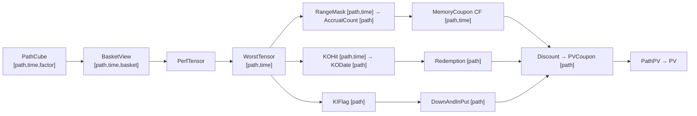

# 03 — Tensor Engine (PathCube & All That Flows From It)

> **Status:** Normative for layouts/precision; descriptive for rationale.

---

## 1. Why a tensor engine

Profiling establishes that for structured products the bottleneck is
**path-dependent state management**, not RNG (RNG ≈ 1–5% of runtime on modern
implementations). The wins therefore come from changing *how state flows*, not from a faster
normal generator:

| Technique | Realistic gain |
| --- | --- |
| Better RNG | 1.01× |
| Better normal generator | 1.05× |
| SIMD | 3–10× |
| SoA memory layout | 2–5× |
| GPU | 10–100× |
| Sobol/QMC | 2–20× |
| Shared scenario cube | 10–100× |
| Trade clustering | 2–10× |

The last two dominate; SIMD and GPU *amplify* them. Tensorisation is the mechanism that
makes them composable.

## 2. The PathCube

The canonical artefact is a **market scenario cube**:

```
PathCube[path][time][factor]
```

Example: 1 000 000 paths × 1 260 timesteps × 350 factors.

- **Raw size** — `1e6 × 350 × 1260 × 8 bytes ≈ 4 TB` of doubles. Impossible to store whole.
- Therefore the engine **must not** materialise the full cube. It stores or streams
  differently (see §5).

### 2.1 `1M paths` semantics

`1M paths` means **1M joint market scenarios across all factors**, *not* 1M paths per risk
factor. One path = one joint realisation of all factors (otherwise correlation is
destroyed).

```
Path 1:   AAPL trajectory, TSLA trajectory, NVDA trajectory
Path 2:   AAPL trajectory, TSLA trajectory, NVDA trajectory
...
Path 1M:  ...
```

### 2.2 Reuse hierarchy

Reuse is ranked from highest to lowest below. riga-flow designs reuse *one layer lower* than
final paths:

| Reuse | Asset |
| --- | --- |
| Highest | RNG streams |
| Very high | Brownian motions `W[path,time,factor]` |
| High | factor scenarios |
| Medium | asset paths |
| Low | basket-specific worst-of paths |
| Very low | final payoff states |

> **Design rule.** Do not design around reusing basket paths — with 400 names and
> combinatorial baskets, basket-level reuse is negligible. Design around reusing
> **market factors → correlated shocks → scenario blocks** and evaluating many payoffs
> against them.

## 3. Stage-wise tensor flow (the memory map)

This is the memory map through the payoff graph, developed stage by stage. Every
stage is a pure tensor transition.

| Stage | Transition | In-shape | Out-shape | Note |
| --- | --- | --- | --- | --- |
| 0 | PathCube | — | `[path,time,factor]` (e.g. `[1e5,60,400]`) | the expensive object |
| 1 | Basket selection | `[path,time,factor]` | `[path,time,basket]` | **view/gather, no copy** |
| 2 | Performance norm | `[path,time,basket]` | same | `S_i(t)/S_i(0)`, no branching |
| 3 | WorstOf | `[path,time,basket]` | `[path,time]` | **massive compression; first cache** |
| 4 | KO gate + first-hit | `[path,time]` | `[]bool`→`[path]` | `w ≥ KO`; first-true scan |
| 5 | KI gate | `[path]` (final fixing) | `[path]` bool | European: only `w_T` |
| 6 | Range accrual | `[path,time]` | `[path,time]` mask → `[path]` count | `L ≤ w ≤ U` |
| 7 | Memory coupon | `[path,time]` masks | `[path,time]` CF | **segmented/masked scan** |
| 8 | Down-and-in put | `[path]` KI + `w_T` | `[path]` | `(K−w_T)⁺` gated by KI |
| 9 | Redemption | `[path]` KO date + KI | `[path]` | par on KO, else maturity |
| 10 | Discount | `[path,time]` CF + `DF[time]` | `[path]` | multiply + sum |
| 11 | Aggregate | `[path]` legs | scalar PV | `mean(PathPV)` |



### 3.1 The pivotal node

`WorstTensor` is "the true bottleneck-cutting node": everything after it operates on
`[path,time]`, not `[path,time,underlying]`.

```
[100000,60,3]  collapses to  [100000,60]
[100000,60,10] collapses to  [100000,60]
```

This collapse is where most portfolio-level tensorisation leverage comes from: a *small set
of path-state tensors* (worst-of, KO date, KI flag, coupon eligibility) turns the rest of the
payoff graph into dense tensor transforms.

## 4. Memory layout rules

**Never** `Vec<Path>`. **Never** a runtime `struct Trade { … }` array iterated per trade.

### 4.1 Struct-of-Arrays (SoA)

```rust
// Bad — AoS (SIMD-hostile)
struct Path { s1: f32, s2: f32, s3: f32, s4: f32, s5: f32 }

// Good — SoA (SIMD-friendly)
s1[path], s2[path], s3[path], s4[path], s5[path]
```

### 4.2 Preferred physical layout

```rust
#[repr(C)]
struct Tensor {
    data: Vec<f32>,
    // shape metadata
}
```

Physical order `[path][time][factor]`, flattened:

```
index = ((path * time_count) + time) * factor_count + factor
```

Factor-major variants exist for the factor engine (`FactorCube`), but the **payoff-graph
default is `[path][time][...]`** because the reduction axis is the factor/basket axis.

### 4.3 Precision

| Object | Precision | Reason |
| --- | --- | --- |
| PathCube, masks, intermediates | `f32` | halves bandwidth; sufficient for MC error budget |
| Final PV, Greeks, calibration | `f64` | accuracy where it compounds |
| Bit-packing | `bool` masks packed (e.g. `[path,time]` bool = ~0.75 MB for 6M bits) | memory |

Worked sizes (100k paths):

| Tensor | Size |
| --- | --- |
| `WorstTensor[1e5,1260]` f32 | ≈ 504 MB |
| one bool mask `[1e5,1260]` | ≈ 15 MB packed |
| temporaries | 200–500 MB |
| `PathCube` block (4096×1260×3) f32 | ≈ 60 MB |

## 5. The storage problem and its three answers

Full cube is impossible, so the industry options riga-flow uses are:

1. **Generate on demand** — scenario block → price block of trades → discard.
2. **Store compressed factors** — e.g. compress 400 equities to ~20 PCA factors.
3. **Store Brownian streams only** — `W[path,time,factor]`, reconstruct paths.

riga-flow default = **option 1 (path blocking) with option 3 for CRN reuse**:

```
Scenario blocks of ~4096 paths at a time.
Reuse the same W for Base / Up / Down bumps.
```

Path blocking is mandatory because `W[1e5,1260,400]` f32 is ≈ 200 GB ("Impossible").

## 6. Scan primitives

Several payoff-graph nodes are not elementwise; they are **scans**. riga-flow owns these.

| Primitive | Use | Differentiable? |
| --- | --- | --- |
| `cumsum` | global running total | Yes (linear) |
| `segmented_scan` | cumsum within segments (per coupon period) | Yes (piecewise linear) |
| `masked_scan` | running total that resets on a mask | Yes almost everywhere |
| `first_true` / `argmax` | first KO hit | Piecewise constant |
| `cummax` | running maximum | **Not differentiable at ties** |

See [`04-payoff-graph.md`](04-payoff-graph.md) for how these compose into the memory-coupon
state machine, and [`design/13-rng-and-qmc.md`](../design/13-rng-and-qmc.md) for QMC.

## 7. Invariants

- **I-T1** Physical payoff layout is `[path][time][factor]` unless a documented exception.
- **I-T2** Factor/basket reductions shrink dimensionality as early as possible.
- **I-T3** `WorstTensor` is cached; downstream nodes never re-read the factor axis.
- **I-T4** Basket selection is a gather/view, not a copy.
- **I-T5** Masks are bit-packed; hot-path state never allocates.
- **I-T6** f32 intermediates, f64 at PV/Greek/calibration boundaries.
