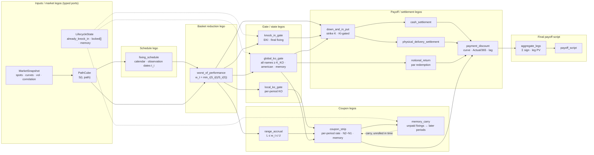

# 04 — Payoff Graph

> **Status:** Normative for node contracts; the node set is the v1 pricing scope.

---

## 1. Design principle

Each **block in the payoff graph is a Petri-net transition** implemented as an
`#[inline(always)]` Rust function at runtime. The Petri abstraction lives at the *design*
level; the runtime is "tight branch-predicted code" — exactly how game engines work.

> The important distinction: **`Transition ≠ UI node`.** The UI node is a
> visualisation; the transition is a real executable business component.

The heavyweight lego graph (§6) is the *conceptual* wire-up; the compiled engine is the
linear DAG in [`03-tensor-engine.md`](03-tensor-engine.md) §3, with the cyclic memory-coupon
edge lowered to a scan primitive (§5).

## 2. Node catalog

| Node | Kind | Input ports | Output port | Primitive |
| --- | --- | --- | --- | --- |
| `MarketSnapshot` | source | — | spots, curves, vol, corr | — |
| `PathCube` | source | market, schedule | `[path,time,factor]` | MC |
| `fixing_schedule` | source | dates | `t_i` | calendar |
| `LifecycleState` | source | — | seeded KO/KI/memory state | — |
| `worst_of_performance` | reduce | `[path,time,basket]` | `[path,time]` | `min` over basket axis |
| `knock_in_gate` | gate | `w_T` | `[path]` bool | `w_T ≤ K_KI` (EKI / final) |
| `global_ko_gate` | gate | `w_t` | termination mask | all names `≥ K_KO`; american; memory |
| `local_ko_gate` | gate | `w_t` | per-period termination | per-period KO |
| `range_accrual` | mask | `w_t` | `[path,time]` bool | `L ≤ w_t ≤ U` |
| `coupon_strip` | cashflow | range mask | `[path,time]` CF | per-period rate, N2−N1 |
| `memory_carry` | state | coupon strip + KO | `[path,time]` CF | **segmented/masked scan** |
| `down_and_in_put` | payoff | KI flag + `w_T` | `[path]` | `(K − w_T)⁺` |
| `notional_return` | payoff | KO date | `[path]` | par redemption |
| `cash_settlement` | settle | put/DIP branch | `[path]` CF | cash-settled put |
| `physical_delivery_settlement` | settle | delivery flag | `[path]` CF | worst-name delivery |
| `payment_discount` | cashflow | CF | `[path]` | curve · Actual/365 · lag |
| `aggregate_legs` | reduce | leg PVs | `[path]` | `Σ sign · leg PV` (PUT/FUNDING/COUPON) |
| `payoff_script` | output | aggregate | rendered decomposition + per-path payoff | — |

## 3. The lego graph (conceptual)

The Phoenix economics can be rendered as typed ports over "legos". This is the reference
the node catalog implements:



### 3.1 The cyclic edge

`CS → MC → CS` looks cyclic. A pure DAG engine "cannot execute this literally". The
resolution: at **compile time** the graph is `RA → MC → CS`; at **runtime** the feedback
loop is *lowered to `segmented_scan()`*, which internally handles carry, reset and
accumulate without a graph cycle. See §5.

## 4. Stage formats (recap of the memory map)

The full stage table lives in [`03-tensor-engine.md`](03-tensor-engine.md) §3. Two stages
deserve their own treatment here: **KO detection** and **memory coupon**.

### 4.1 KO detection

```
WorstTensor [path,time]  →  ko_hit = w ≥ KO  →  [path,time] bool
                                             →  first_true()  →  KODate [path]
```

`first_true()` (or `argmax(ko_hit)`) yields the **first** KO only, compressing `[path,time]`
to `[path]`. Example: Path1→month 18, Path2→never, Path3→month 9.

### 4.2 KI detection

Phoenix is usually **European KI**: only the final fixing is needed, so

```
WorstTensor[:, T]  →  [path]  →  ki = w_T < KI  →  KIFlag [path]
```

No path traversal remains after worst-of reduction.

## 5. Deep dive — memory coupon as a tensor scan

This is where the payoff graph "stops being purely stateless transforms and starts looking
like a state machine".

### 5.1 The imperative form

```
missed = 0
for month:
    if KO:
        pay(missed + coupon); break
    if worst >= coupon_barrier:
        pay(missed + coupon); missed = 0
    else:
        missed += coupon
```

Looks anti-vectorisation; it is not.

### 5.2 The tensor form

Given `WorstTensor [path,time]` and (say) worst = `[70,75,85,90,102]`, coupon barrier 80,
KO 100:

| Step | Operation | Result |
| --- | --- | --- |
| 1 | `coupon_eligible = worst ≥ coupon_barrier` | `[0,0,1,1,1]` |
| 2 | `ko_hit = worst ≥ KO` | `[0,0,0,0,1]` |
| 3 | `ko_date = first_true(ko_hit)` | `5` |
| 4 | `alive_mask` (broadcast KO date to daily/monthly) | `[1,1,1,1,1]` (if KO at 3 → `[1,1,1,0,0]`) |
| 5 | `effective_coupon = coupon_eligible & alive_mask` | — |
| 6 | `miss_mask = alive & !coupon_eligible` | `[1,1,0,0]` |
| 7 | `cumsum(miss_mask)` | `[1,2,2,2]` — misses so far |

`cumsum` alone is **not enough**: after a payment the memory must reset. So build a reset
flag from `coupon_eligible` and lower to a **segmented scan**:

| Step | Operation | Result |
| --- | --- | --- |
| 8 | `reset = coupon_eligible` | `[0,0,1,1]` |
| 9 | `group_id = cumsum(reset)` | `[0,0,1,2]` |
| 10 | `cumsum(miss_mask) within group` | `[1,2,0,0]` |
| 11 | coupon paid at reset = `(misses_before+1)·rate` | month3 → 15%, month4 → 5% ✅ |

The `CS → MC → CS` feedback edge is exactly step 10's `segmented_scan`. GPU libraries
implement this primitive (CUB, Thrust, oneAPI, JAX, PyTorch, TensorFlow) because it appears
everywhere in databases and graph processing.

### 5.3 Masked scan definition

```
normal cumsum:  running += x[i]
masked scan:    if reset { running = 0 }; running += x[i]

values  1 1 0 1 1 1
reset   0 0 1 0 0 1
result  1 2 0 1 2 0
```

### 5.4 State representation

After `WorstTensor`, Phoenix state is a set of `[path,time]` tensors:

```
alive_mask, ko_mask, coupon_mask, memory_bucket, group_id
```

and the memory coupon is no longer a loop but a primitive:

```rust
memory_coupon = segmented_scan(coupon_mask, alive_mask, ko_mask);
```

## 6. Mixed observation topologies (daily RA + monthly KO)

A common case is **range accrual daily but KO/KI monthly**. This
*makes the graph more tensor-friendly, not less*.

```
PathCube
    ↓
WorstDailyTensor [path,1260]
    ├── RangeMask        [path,1260]  → segment-reduce by month → CouponTensor [path,60]
    └── MonthlyProjection
             ↓
        WorstMonthlyTensor [path,60]
             ├── KI Gate → KIFlag [path]
             └── KO Gate → KODate [path]
```

Key consequences:

- Work scales with observations (60 → 1260, ≈21×) but the added ops are
  `compare / mask / prefix scan / segment reduction` — the operations tensors do best.
- KO lifetime is broadcast to daily: `AliveDaily[path,1260]` from `KODate[path]`, then
  `effective_accrual = RangeMask & AliveDaily`. **No branching — just masks.**
- Memory coupon becomes *easier*: `coupon = rate · (accrual_days / business_days)` is a
  `segment_sum` over the daily tensor, often with **no memory state** at all.

Revised runtime share (estimate):

| Component | Monthly obs | Daily RA + Monthly KO |
| --- | --- | --- |
| Path evolution | 20% | 10–15% |
| Barrier/coupon logic | 40% | 60–70% |
| Discounting | 5% | 2% |
| Misc | 35% | 20% |

> **Conclusion.** The heavier the product is in observation logic, the *more* benefit the
> payoff-graph/tensor execution model delivers over a nested `for(path) for(date)` loop.

## 7. Node contract (normative)

Every payoff node MUST declare:

```rust
struct NodeSpec {
    id: NodeId,
    kind: NodeKind,                 // reduce | gate | mask | cashflow | settle | scan | reduce
    inputs: Vec<PortSpec>,          // name, dtype, shape, axis meaning
    outputs: Vec<PortSpec>,
    trace_events: Vec<EventSpec>,   // events emitted at TraceLevel ≥ Sampled
    attribution: Vec<LegId>,        // PV legs this node contributes to
    differentiable: DiffKind,       // Smooth | PiecewiseLinear | Step | NonDiff
}
```

`differentiable` is consumed by the AAD analysis in
[`06-risk-engine.md`](06-risk-engine.md): `min`/`max`/barrier indicators are `Step`;
`cumsum`/`segmented_scan` are `PiecewiseLinear`; `cummax` is `NonDiff` at ties.

## 8. Invariants

- **I-P1** Every node is a pure tensor transition (no trade loops, no hidden state).
- **I-P2** Cyclic edges are lowered to scan primitives; the compiled graph is a DAG.
- **I-P3** Factor-axis reductions happen at or before `worst_of_performance`.
- **I-P4** KO/KI termination is expressed as masks broadcast over the finer schedule.
- **I-P5** Memory coupon is expressed as a segmented/masked scan, never a loop.
- **I-P6** Every node declares its trace events and its attribution legs.
