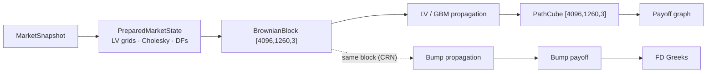

# 05 — Market Models & Path Propagation

> **Status:** Normative for the model contract; Dupire Local Vol is the target model.

---

## 1. Model tiers

Three model tiers are in scope; riga-flow must implement all three because the book is
heterogeneous and the model choice changes both the runtime profile and the reuse story.

| Tier | Model | Per-step cost | Path-generation share | Primary bottleneck |
| --- | --- | --- | --- | --- |
| 1 | Black–Scholes / GBM | cheap | ~20% | payoff logic |
| 2 | Multi-asset Worst-of | + correlation transform | ~20% | event logic |
| 3 | **Dupire Local Vol** (target) | surface lookup + interp | **50–70%** | LV lookup + propagation |

### 1.1 Tier 1 — GBM

```
S_{t+Δt} = S_t · exp( (r − q − ½σ²)Δt + σ√Δt · Z )
```

RNG is 2–10%; `exp()` and payoff dominate. Spot bumps can be applied by scaling (see
[`06-risk-engine.md`](06-risk-engine.md)).

### 1.2 Tier 2 — Multi-asset worst-of

```
Z ~ N(0, I)        (per-step independent normals)
Y = L Z            (Cholesky of correlation)
worst = min_i S_i(t)/S_i(0)
```

Cost split: Cholesky transform 20–30%, asset evolution 20–30%, worst-of 15–25%, event logic
20–30%. RNG falls to 1–3%.

### 1.3 Tier 3 — Dupire Local Vol (the default target)

```
dS_t = μ S_t dt + σ_LV(S_t, t) · S_t dW_t
```

Volatility depends on **time and current spot along the path**, so:

- every step requires a **surface lookup** (`σ_LV(S,t)`) — billions of evaluations,
- a bumped spot changes *every subsequent lookup*, so paths generally cannot be rescaled;
  they must be **re-propagated**.

Runtime share under Dupire LV:

| Component | Share |
| --- | --- |
| LV interpolation | 30–40% |
| Path propagation | 20–30% |
| Payoff graph | 20–30% |
| Discounting/stats | 5% |
| Other | 5% |

> "Path generation is no longer 20%. It's closer to 50–70% including LV lookup."

## 2. Consequences for the architecture

The Dupire shift moves the bottleneck **upstream** and changes the optimisation ranking.

| Rank | Technique (Dupire LV book) |
| --- | --- |
| 1 | Trade clustering |
| 2 | **GPU surface interpolation** |
| 3 | Common Random Numbers |
| 4 | Path blocking |
| 5 | Tensorized payoff graph |
| 6 | Scenario reuse |
| 7 | RNG optimization |

Note how **path reuse drops to near-last**. Payoff tensorisation still helps but is a smaller
share than under GBM. The surprising conclusion: under Dupire LV, headroom
lives in turning **LV lookup + propagation + FD bump propagation** into batched tensor
workloads.

## 3. Propagation contract

The factor engine owns evolution and is **implemented in-house** (not on top of a generic MC
framework). The rule:

> "A production LV engine ends up dominated by `vol_surface.interpolate()` inside
> `for path for timestep` — billions of times."

### 3.1 Trait

```rust
trait Process {
    /// Evolve one time-step for a block of paths.
    /// `z` is the Brownian block [path, time, factor]; CRN means the same
    /// block is reused across bumps.
    fn evolve(&self, market: &PreparedMarket, z: &BrownianBlock, out: &mut PathCube);
}
```

Implementations: `Gbm`, `DupireLocalVol`, `Heston` (optional later).

### 3.2 LV surface

- Build a **precomputed grid** for fast lookup (from `PreparedMarketState`).
- Interpolate (bilinear/bicubic) in `(spot, time)`.
- Optimise for **SIMD lookup** first, **GPU texture/sampled lookup** later.
- Local-vol calibration (from the implied vol surface via Dupire) is a separate pipeline
  stage; calibration uses `f64`.

## 4. Common Random Numbers (CRN) — mandatory for FD

Under both GBM and LV, the **reusable asset for Greeks is not the path, it is the Brownian
stream** `Z[path,time,factor]`.

```
Base:     reuse Z → propagate
Spot Up:  reuse same Z → propagate
Spot Down:reuse same Z → propagate
```

This is "called CRN (Common Random Numbers) and is almost mandatory for FD Greeks" —
variance reduction can cut required paths by an order of magnitude. The earlier answer to
"is RNG reuse worth it?" is nuanced: *not much for base pricing, absolutely for Greeks*.

| Bump | Resimulate? | Why |
| --- | --- | --- |
| Spot (GBM) | No | reseal path by scaling |
| Spot (LV) | Yes (re-propagate) | `σ(S,t)` changes along path |
| Dividend | Usually no | |
| Discount curve | No | only discounting changes |
| Coupon/KI/KO barrier | No | payoff-only |
| Vol (stochastic) | Yes | dynamics change; reuse `Z` |
| Correlation | Yes | `Y' = L' Z`, reuse `Z` |

## 5. Memory reality

`BrownianCube [1e5,1260,400]` f32 ≈ **200 GB** — cannot be stored. Hence:

- **path blocking**: brownian blocks of ~4096 paths at a time (~60 MB f32),
- regenerate or stream blocks as the scheduler walks them,
- keep CRN per block so Base/Up/Down share the same block.



## 6. Library posture

| Layer | Own or borrow |
| --- | --- |
| Maths (RNG, linear algebra, parallelism) | **borrow** (`rand`, `nalgebra`, `rayon`) |
| Market model (`Process`, `DupireLV`, `Heston`) | **own** — performance-critical |
| Path storage (`PathCube`, `FactorCube`) | **own** — layout = 2–5× perf |
| Payoff graph | **own** — the differentiator |
| Vol-surface interpolation inside the path loop | **own** |

The conclusion: for a portfolio-centric engine, ~**80–90% custom code, 10–20%
commodity libraries**. Depending heavily on a full MC framework (e.g. `stochastic-rs`) is
fine for proof-of-concept, validation and benchmarking, but "you will start fighting the
framework" once Phoenix, memory coupon, worst-of, daily range accrual, Dupire LV, GPU
batches, FD Greeks and CRN are involved.

## 7. Invariants

- **I-M1** The evolution step is a pure tensor op over a path block.
- **I-M2** CRN is preserved across all bumps of one path block.
- **I-M3** The Brownian stream, not the path, is the unit of reuse.
- **I-M4** LV lookup is optimised (grid + SIMD, later GPU) before any RNG micro-optimisation.
- **I-M5** Calibration and final PV use `f64`; path tensors use `f32`.
- **I-M6** The market model is owned in-house; only maths plumbing is borrowed.
