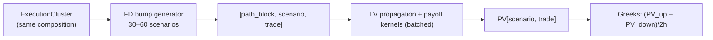

# 06 — Risk Engine (FD Greeks, CRN, AAD)

> **Status:** Normative for the FD+CRN production path; AAD is "explored".

---

## 1. FD Greeks dominate the compute budget

```
Overnight PV      =  5%  of total compute
Greeks/XVA/FRTB   = 95%  of total compute
```

The engine must therefore treat risk as the primary workload, not an afterthought.

### 1.1 The FD explosion

For a Phoenix referencing 3 stocks, 1 rate curve, 1 funding curve, 1 vol surface:

| Risk factor | Count |
| --- | --- |
| Spot | 3 |
| Vol | 3 |
| Rates (curve nodes) | ~20 |
| Correlation pairs | 3 |
| **Total** | **~30** |

Central FD needs `1 + 2×F` valuations per trade:

```
F = 30  ⇒  61 valuations per trade
100k trades ⇒ 6.1 million valuations   (not 100k)
```

## 2. What each bump can reuse

The key insight is that many FD bumps do not need resimulation:

| Bump | Resim? | Reuse |
| --- | --- | --- |
| Spot (GBM) | no | scale path; `Z` unchanged |
| Spot (Dupire LV) | yes | re-propagate; **reuse `Z`** |
| Dividend | usually no | |
| Discount curve | no | only discounting |
| Coupon / KI / KO barrier | no | payoff-only |
| Vol (stochastic) | yes | reuse `Z` |
| Correlation | yes | `Y' = L' Z`; reuse `Z` |

> **The reusable asset is the Brownian cube `Z[path,time,factor]`, not the PathCube.**

## 3. Bump batching (tensor form)

Instead of Base / Up / Down separately, evaluate them together:

```
[path_block, bump_batch, trade_batch]   or   [path, scenario, trade]
```

Example: `4096 paths × 61 scenarios × 2500 trades` in **one pass** — the tensor the GPU
loves. This is where portfolio tensorisation earns its keep for risk.



## 4. AAD — explored, not the default

AAD must be weighed carefully.

### 4.1 Differentiability of the primitives

| Primitive | Differentiable? |
| --- | --- |
| `cumsum` | Yes — linear operator (lower-triangular ones) |
| `masked` / `segmented` scan | Yes almost everywhere (piecewise linear) |
| `cummax` | **No at ties** (like `max(a,b)`) |
| `min` / worst-of | **No at ties** — already present in Phoenix |
| KO/KI indicators | `0` almost everywhere, explosive near barrier |

```
PV = max(S−K, 0)  ⇒  AAD delta ∈ {0,1}; fine except near S≈K
```

AAD computes the derivative *of the implemented function*; it does not require smoothness.
The real problem is that barriers make derivative jumps that **hurt FD and AAD equally**.

### 4.2 AAD verdict

For a book of 100k trades with hundreds of risk factors:

```
FD  cost ~ O(number_of_risk_factors)      (61 valuations/trade)
AAD cost ~ O(1)   relative to inputs
```

AAD *could* be an order-of-magnitude win, and "the real competition is increasingly FD vs
AAD". **But** under Dupire LV with worst-of, barriers, memory coupon, KO/KI and `cummax`,
"the implementation complexity grows enormously while FD + CRN often remains the pragmatic
production choice for structured products desks."

> **Decision.** Production path = **FD + CRN + Sobol + GPU + tensorised payoff + path
> blocking**. AAD is a research track behind a feature flag; its cost model is exposed as a
> tool but it is not on the critical path (see
> [`../design/10-architecture-decisions.md`](../design/10-architecture-decisions.md) ADR-9).

## 5. FD Greeks as a tensor workload

For a `2000`-trade cluster with the same topology:

```
[4096 paths, 3 bumps, 2000 trades]
```

Base/Up/Down are evaluated together; the reduction `(PV_up − PV_down) / (2h)` is a trivial
elementwise op over `[scenario, trade]`.

### 5.1 Convergence and validation

- Validate FD against a reference (bump-and-revalue vs analytic where available).
- Validate CRN variance reduction: same seed, compare path counts for equal CI width.
- Greeks are `f64`.
- Report MC error alongside every Greek.

## 6. Expected realistic gains (Dupire LV)

Baselines matter; no 100× claim is made here.

| Baseline | PV only | FD Greeks |
| --- | --- | --- |
| Single-core QuantLib | 10–100× | 10–100× |
| Modern multicore QuantLib + OpenMP + CRN + Sobol | 3–10× | 5–20× |

Component breakdown vs a decent multicore implementation:

| Optimisation | Gain |
| --- | --- |
| Tensorized payoff graph | 1.3–3× |
| GPU LV propagation | 2–10× |
| Better clustering | 1.5–4× |
| Better memory locality | 1.2–2× |

Combined: **3–20×** "feels realistic" under Dupire LV — e.g. an 8-hour overnight run
becomes 30–90 minutes.

## 7. Invariants

- **I-R1** Every FD bump for a path block reuses the same Brownian stream (CRN).
- **I-R2** Bumps are batched into a tensor; never evaluated one trade at a time at top level.
- **I-R3** Greeks are `f64` and carry an MC error estimate.
- **I-R4** Barrier/`min`/`cummax` nodes are flagged `Step`/`NonDiff`; no automatic AAD
  smoothing is applied to production results.
- **I-R5** AAD is feature-flagged and never silently substituted for FD.
