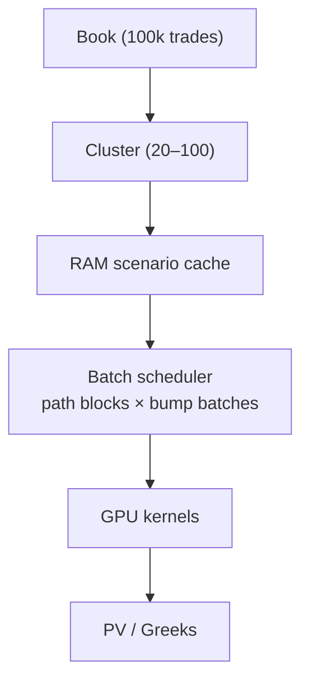

# 07 — Clustering & Batch Scheduler

> **Status:** Normative for cluster keys; the scheduler strategy is as specified below.

---

## 1. Clustering is mandatory

GPU divergence destroys performance: a warp of 32 lanes all executing
`if (worst > barrier)` with **different** barriers (`62%, 71%, 80%, 59%, …`) "explodes" the
branch cost. So trades are **clustered before evaluation**.

Two distinct concepts:

| Concept | Contains | Used for batching? |
| --- | --- | --- |
| `TradeIdentity` | exact trade id, exact maturity, exact basket, exact barriers | **Never** |
| `ExecutionCompositionKey` | payoff family, basket cardinality, observation topology, settlement, memory-coupon flag, KI/KO type | **Yes** |

```rust
struct ExecutionCompositionKey {
    payoff_family:       PayoffFamily,       // Phoenix | Snowball | Athena | KIKO | ...
    basket_cardinality:  u8,                 // 1 | 3 | 5 | 10
    observation_topology:ObservationTopology,// MonthlyKO+MonthlyRA | MonthlyKO+DailyRA | ...
    settlement_type:     SettlementType,     // Cash | Physical
    memory_coupon:       bool,
    knock_in_type:       KnockInType,
    knock_out_type:      KnockOutType,
}
```

### 1.1 The four cluster levels

Four cluster levels are defined; the composition key generalises them:

1. **Payoff family** — never mix Phoenix, Athena, Snowball, KIKO.
2. **Observation structure** — `DailyRA + MonthlyKO` ≠ `MonthlyRA + MonthlyKO` (different
   tensor shapes).
3. **Basket cardinality** — WorstOf3 / 5 / 10 have different reduction kernels.
4. **Tenor bucket** — do *not* mix 1Y/3Y/5Y/10Y in one kernel (dead work to `maxTenor`).

## 2. Maturity date is the WRONG cluster key

For a live book with 100k trades and 200 maturity dates and new issuance every day, maturity
clustering is explicitly rejected:

> "maturity date itself is usually the wrong clustering key."

Why: two trades maturing one day apart have almost identical path dimensions; forcing separate
clusters collapses GPU utilisation.

**Fix: normalise to a grid** (1Y/2Y/3Y/5Y/7Y/10Y, or 252/504/756/1260 trading days) and
handle mixed tenors *inside* a cluster with a mask:

```
maturity_idx[trade]                    # [n_trades]
active = time_idx <= maturity_idx      # broadcast mask — exactly like a KO mask
```

No new cluster required for mixed maturity.

### 2.1 Realistic cluster counts

| Approach | Clusters | Trades/cluster |
| --- | --- | --- |
| Trade-per-cluster | 100 000 | 1 → disaster |
| Maturity-date | 200 | ~500 → GPU under-utilised |
| **Composition key** | **20–100** | **1 250–5 000+** |
| Theoretical product of all axes | 320 | many empty |

A cluster "may easily contain 5 000–20 000 trades despite having hundreds of different
maturity dates". The execution engine cares about **tensor-shape compatibility**, not
economic maturity.

## 3. Scheduler

The scheduler is the bridge between book, RAM and GPU VRAM.



### 3.1 Execution hierarchy (from Phase-10 acceptance)

```
Cluster
  → Scenario Batch (Base / Up / Down …)
     → Path Block (4096 paths)
        → Tensor Graph (nodes)
           → Greeks
```

No trade-level simulation loop may remain in the top-level flow.

### 3.2 Parallelism levels

| Level | Scope | Mechanism |
| --- | --- | --- |
| 1 | Cluster | `rayon` |
| 2 | Scenario | Base/Delta/Vega/DV01 parallel |
| 3 | Path block | 4096-path blocks |
| 4 | SIMD | `std::simd` inside a block |
| 5 | GPU | `cudarc` / `wgpu` |

## 4. Hardware budgets (the 3060 Ti worked example)

Reference rig: **RTX 3060 Ti (8 GB VRAM) + 64 GB RAM**, 100k Phoenix-like
book. "The bottleneck is absolutely GPU VRAM, not RAM."

| Object | Size |
| --- | --- |
| `WorstTensor[1e5,1260]` f32 | ≈ 504 MB |
| KO/coupon/range masks | ~15 MB each |
| temporaries | 200–500 MB |
| one payoff family resident | **1–2 GB** |
| trade metadata (5000 × ~256 B) | ≈ 1.3 MB |

Trade definitions are **negligible**; the factor/path tensors dominate. Hence:

> Reduce the **factor dimension early** (`PathCube[path,time,factor] → WorstTensor[path,time]`)
> rather than reducing the number of trades in memory.

### 4.1 Capacity

- A 3060 Ti can "evaluate thousands to tens of thousands of similar trades together".
- Do **not** attempt 100k trades in one batch: `100k → 20–100 clusters → 500–5000 / cluster`.
- Resident footprint target ≈ **2–3 GB** per active payoff family.

## 5. Composition key + scheduler as engine components

| Component | Responsibility |
| --- | --- |
| `ClusterPlanner` | map trade identities → composition keys → clusters |
| `ScenarioCache` | hold/generate Brownian blocks on demand, LRU by block |
| `BatchScheduler` | walk clusters × scenarios × path blocks; enforce CRN |
| `KernelRegistry` | fn per `(payoff_family, observation_topology, cardinality)` |
| `BackendPool` | CPU (`rayon`) / SIMD / GPU (`cudarc`) selection |

## 6. Invariants

- **I-C1** Batching uses `ExecutionCompositionKey`, never `TradeIdentity`.
- **I-C2** Maturity is masked inside a cluster, not used as a cluster key.
- **I-C3** Trades sharing a cluster share tensor shapes and kernel.
- **I-C4** CRN is preserved per path block across scenarios.
- **I-C5** No cluster may be so small that kernel launch overhead dominates.
- **I-C6** Memory planning reduces the factor axis before the trade axis.
