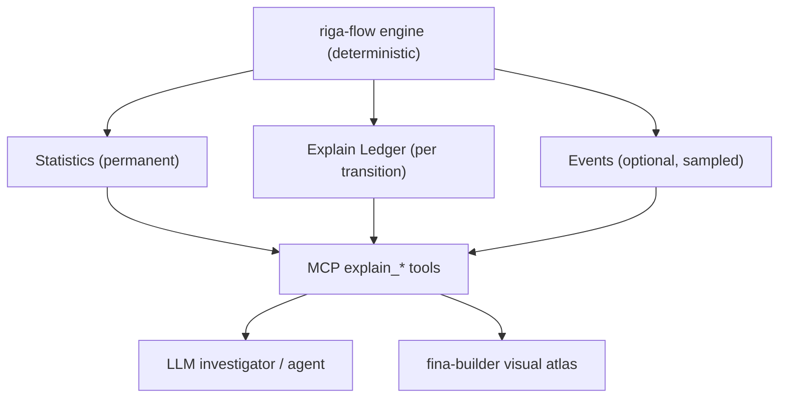

# 08 — Explainability, Statistics & the LLM Investigator

> **Status:** Normative for the ledger/stats model; descriptive for LLM integration.

---

## 1. The pain points this engine must answer

The LLM opportunities are ranked by ROI below. riga-flow's obligation is to make each
**answerable from structured evidence**:

| # | Pain point | Trader/validator question | Evidence riga-flow must persist |
| --- | --- | --- | --- |
| 1 | Risk attribution | "Why is today's PV different?" | attribution ledger + per-node PV/Δ/Vega delta |
| 2 | Greek validation | "Are these Greeks reasonable?" | Greeks + population stats + economic-intuition rules |
| 3 | Scenario discovery | "Which scenarios should we run?" | barrier-proximity + payoff-discontinuity detection |
| 4 | Report interpretation | "What are the 3 most important risks?" | ranked statistics + semantic index |
| 5 | Regression testing | "Which trades broke after the SIMD/GPU change?" | baseline vs optimised corpus + tolerances |
| 6 | Validation-failure RCA | "Why did trade #2981 move 1.9%?" | event-sourced replay + change log correlation |
| 7 | Governance/audit | "Write the model-change summary." | structured evidence export |
| 8 | Interactive PathCube | "Show paths leading to the worst 5%." | PathCube query + cluster profiling |

Where LLMs add **no** value is equally binding: Sobol/Brownian bridge,
path simulation, barrier detection, coupon evaluation, LSM regression, Greeks bumping, AAD,
P&L explain, curve calibration and vol-surface interpolation are **deterministic numerical
tasks**. Rule: `CPU/GPU > Quant model > Statistics`, not `LLM > Quant model`.

## 2. The architecture

```
Monte Carlo Engine
    ↓
Risk Analytics
    ↓
PathCube
    ↓
Explain Ledger
    ↓
LLM Investigator
```

"Do not let an LLM anywhere near the pricing path." The LLM is "a senior model-validation
analyst sitting on top of a deterministic analytics stack".



## 3. The three net layers (model side)

The atlas specifies three Petri views. riga-flow **models** all three; `fina-builder`
**renders** them.

### 3.1 Layer 1 — Execution Petri Net

Places, transitions, token counts; each transition reports input/output populations and a
firing probability.

```
Obs3 KO Trigger
  input:  Alive = 54,211
  output: KO = 8,322 ; Alive = 45,889
```

Backed by `TransitionStats` (see [`02-execution-model.md`](02-execution-model.md) §1.1).

### 3.2 Layer 2 — Risk Propagation Petri Net

A net **separate from path flow**, tracking risk concentration through transitions:

```
KO paths    : Delta = 0.05, Vega = 0.02
Alive paths : Delta = 0.91, Vega = 0.85
```

Risk concentration becomes observable per place. Backed by per-node
`delta_contribution / vega_contribution / gamma_contribution / funding_contribution`.

### 3.3 Layer 3 — Explainability Petri Net

Metadata is attached to transitions:

```json
{
  "condition": "WorstOf > 105%",
  "population_before": 50321,
  "population_after": 11221,
  "pv_impact": -1.34,
  "delta_impact": -0.06
}
```

"The LLM can query this directly."

## 4. The Explain Ledger

The ledger is the canonical execution record — "the Petri net becomes the canonical
execution ledger". It is **not** a debugger log.

### 4.1 Contents per entry

| Field | Meaning |
| --- | --- |
| `transition_id` | which node fired |
| `condition` | human/machine-readable firing condition |
| `population_before` / `_after` | token counts |
| `pv_impact` | PV change attributable to the transition |
| `delta_impact` / `vega_impact` | risk change attributable to the transition |
| `evidence_refs` | links to trades, market snapshot, code revision, config |

### 4.2 Attribution source

Attribution is **derived from discounted leg PVs already in the tensors** — decompose:

| Leg | Symbol |
| --- | --- |
| Par redemption | `parRedemption` |
| Coupon | `coupon` |
| Memory coupon | `memoryCoupon` |
| Down-and-in put | `downAndInPut` |
| Funding | `funding` |
| Discounting | `discounting` |
| **Total** | `Σ sign · leg PV` |

This mirrors `fina-builder`'s six-component attribution so the two products agree.

### 4.3 Event-sourced replay

Rather than recomputing 1M paths to answer a follow-up:

1. **Deterministic recompute** — identical `(seed, sobol_index, as_of, market)` ⇒ identical
   results; any path reconstructible from identity (Gap #4).
2. **Aggregated replay** — persisted per-transition stats/snapshots answer most questions
   with no recompute.

## 5. Statistics as the first-class artefact

Statistics matter *more* than event logging: "model validators care far
more about population movement than about Path #182848".

Per transition, permanently resident:

```rust
struct TransitionStats {
    input_count, output_count, probability,
    mean_payoff, variance_payoff,
    mean_delta, mean_vega,
}
```

These build — with **no per-path storage**:

- Sankey diagrams,
- PathCube,
- `fina-builder` graphs,
- risk explainability,
- LLM summaries.

### 5.1 PathCube queries

The interactive use case:

> "Show paths leading to the worst 5% outcomes."

Lowered to: `filter(payoff_percentile < 5%) → cluster paths → summarise common
characteristics`. The engine exposes this as a PathCube query tool; the visual atlas draws
the result.

## 6. The investigator contract (what an agent can ask)

riga-flow exposes evidence in a shape an LLM can traverse (see
[`../mcp/31-mcp-tool-catalog.md`](../mcp/31-mcp-tool-catalog.md)):

| Question | Tool |
| --- | --- |
| Why is today's PV different? | `explain_pv_attribution` |
| Which KO dates mattered? | `query_execution_net` |
| Are these Greeks reasonable? | `validate_greeks` |
| Which scenarios should we stress? | `recommend_scenarios` |
| Why did Vega peak at observation 12? | `query_risk_net` |
| Which trades broke after the change? | `triage_regression` |
| Why did trade #2981 move 1.9%? | `root_cause` |
| Summarise for the model committee | `export_governance_evidence` |

Output this must be able to produce:

> "The PV decrease was primarily driven by Vega (−0.52%), particularly from the 85–95%
> strike vol region. Spot contributed −0.39%, amplified by the autocall probability increase
> from Observation #7. Theta accounted for −0.18%. Residual attribution remains within
> Monte Carlo confidence intervals."

And the economic-intuition check:

> "Vega appears unusually low given proximity to the KI barrier. Barrier-dependent products
> often exhibit elevated volatility sensitivity near activation regions. Verification of
> barrier crossing logic may be warranted."

## 7. Boundary vs the visual atlas

| Capability | riga-flow | fina-builder |
| --- | --- | --- |
| Compute stats, ledger, snapshots | ✅ | — |
| Render Petri nets, Sankey, PathCube charts | — | ✅ |
| LLM prompt construction | optional (tool descriptions/prompts) | ✅ (chat panel) |
| Governance document *content* | ✅ (structured evidence) | ✅ (rendering/editing) |

See [`../handoff/41-visual-atlas-spec.md`](../handoff/41-visual-atlas-spec.md).

## 8. Invariants

- **I-X1** No LLM output feeds the pricing/risk path.
- **I-X2** Statistics are always on; events are always optional.
- **I-X3** The ledger is event-sourced and replayable from persisted evidence.
- **I-X4** Every explanation is linked to structured evidence refs.
- **I-X5** Attribution is derived from tensor leg PVs, not re-pricing.
- **I-X6** Determinism requires `(seed, sobol_index, as_of, market)` in every explain request.
