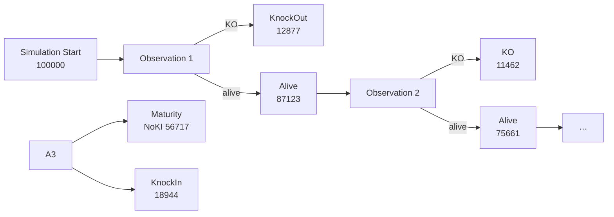

# 41 — Visual Atlas Specification

> **Status:** Handoff specification for `fina-builder`.

---

## 1. What the atlas is

A **microscope over the pricing flow**. Where a debugger answers "why did this line of code
execute?", the atlas answers:

> "Why did this trade end up with this risk profile?"

The atlas renders data produced by riga-flow. It performs no computation.

## 2. Layer 1 — Execution Petri Net

Render places, transitions and token counts.



Requirements:

| Element | Data source | Visual |
| --- | --- | --- |
| Places | `TransitionStats` place ids | nodes, labelled with token count |
| Transitions | payout-graph node ids | edges |
| Token counts | `input_count` / `output_count` | node size / label |
| Firing probability | `probability` | edge width / label |
| First-hit (KO) | `KODate` distribution | branch emphasis |

Example transition detail panel:

```
Obs3 KO Trigger
  input:  Alive = 54,211
  output: KO = 8,322 ; Alive = 45,889
  firing probability: 15.3%
```

## 3. Layer 2 — Risk Propagation Petri Net

A **separate net over the same transitions**, tracking risk concentration.

```
KO paths    : Delta = 0.05, Vega = 0.02
Alive paths : Delta = 0.91, Vega = 0.85
```

| Element | Data source |
| --- | --- |
| Per-place risk | `delta_contribution`, `vega_contribution`, `gamma_contribution`, `funding_contribution` |
| Risk flow | signed contribution along a transition |
| Concentration | heat-map by place |

Requirement: "Now risk concentration becomes observable."

## 4. Layer 3 — Explainability Petri Net

Attach metadata to transitions and render it as an inspector.

```json
{
  "condition": "WorstOf > 105%",
  "population_before": 50321,
  "population_after": 11221,
  "pv_impact": -1.34,
  "delta_impact": -0.06
}
```

| Element | Data source |
| --- | --- |
| Condition | `LedgerEntry.condition` |
| Population | `population_before/after` |
| PV/Delta impact | `pv_impact`, `delta_impact`, `vega_impact` |
| Evidence | `evidence_refs` (links to trades/market/revision) |

Requirement: "The LLM can query this directly" — the atlas also makes it human-queryable.

## 5. Views to render (mapped to riga-flow output)

| View | riga-flow source |
| --- | --- |
| Payoff graph → Execution net | places/transitions/token counts |
| Timeline / lifecycle | execution events per path |
| Branch statistics | `TransitionStats[]` |
| Attribution | six-leg decomposition (`LegAttribution`) |
| Distribution | payoff distributions + `PathPV` |
| Sankey | token flows across places |
| PathCube | `query_pathcube` results (e.g. worst-5% clusters) |
| Risk net | risk-propagation contributions |
| Explain ledger | `LedgerEntry[]` + reconciliation |
| Regression report | `compare_corpus` output (exceptions grouped by family) |
| Scenario comparison | bump scenarios (`compute_risk` per scenario) — replaces the current placeholder |

## 6. Interactive risk exploration (the headline UX)

The flagship interaction:

> **User:** "Why does payoff collapse here?"  **Atlas:** locates cube region → identifies KI
> activation → identifies coupon loss → explains cashflow path.
>
> **User:** "Show paths leading to worst 5% outcomes."  **Atlas:** filters payoff percentile
> < 5% → clusters paths → summarises common characteristics.

The atlas sends `query_pathcube` / `query_execution_net` / `query_risk_net` to riga-flow and
renders the result. It does not compute the clusters.

## 7. LLM investigation panel

The desktop assistant (currently `fina-builder`'s Tauri + llama.cpp panel with three
read-only tools) expands to consume riga-flow's explanation tools and prompts.

```
Risk report  →  semantic interface   (not a 50MB PDF graveyard)
```

| Prompt (riga-flow) | Atlas behaviour |
| --- | --- |
| `explain_pv_change` | open a panel grounded in the ledger |
| `investigate_validation_failure` | RCA over history + change logs |
| `triage_regression` | exception triage list |
| `summarise_risk_report` | "the 3 most important risks" |
| `recommend_stress_scenarios` | stress-band suggestions |
| `compose_governance_section` | model-governance narrative from evidence |

Requirement: the atlas renders **evidence-linked** explanations; it must not present
ungrounded prose as a valuation.

## 8. Rendering requirements / acceptance

- [ ] Execution net renders places/transitions/token counts from `TransitionStats`.
- [ ] Risk net renders per-place risk concentration.
- [ ] Explain net renders transition metadata + evidence links.
- [ ] Sankey, attribution, distribution, PathCube and ledger views consume riga-flow data.
- [ ] Scenario comparison uses real bump scenarios (no three-times-same-`RiskState`).
- [ ] The assistant answers "why" questions from the ledger, not from a re-implementation.
- [ ] No formula is duplicated in `fina-builder` after handoff.

## 9. Data shapes the atlas consumes

See [`42-kernel-contract.md`](42-kernel-contract.md) for the frozen wire shapes
(`TransitionStats`, `LegAttribution`, `LedgerEntry`, `PathIdentity`, net views).
