# 43 — Handoff Plan & Checklist

> **Status:** **Required scope** — the riga-flow prerequisites (§1) are met. Executable build
> prompt: [`45-fina-builder-build-handoff-prompt.md`](45-fina-builder-build-handoff-prompt.md).

---

## 1. Prerequisites (riga-flow side)

The handoff starts only when:

- [ ] `riga-flow` Milestone **M2** complete — PathCube + payoff graph produce PV and stats.
- [ ] `riga-flow` Milestone **M4** complete — FD+CRN Greeks.
- [ ] `riga-flow` Milestone **M3** complete — `TransitionStats`, Explain Ledger, snapshots,
  path identity, replay.
- [ ] `riga-flow` Phase **12** complete — `riga-mcp` over **stdio** and **Streamable HTTP**.
- [ ] The frozen contract ([`42-kernel-contract.md`](42-kernel-contract.md)) is published
  and versioned.

## 2. Sequencing

```mermaid
flowchart LR
    P0["0. Freeze contract"] --> P1["1. Engine-adapter spike (stdio)"]
    P1 --> P2["2. Replace demo numerics in fina-kernel"]
    P2 --> P3["3. Petri execution net view"]
    P3 --> P4["4. Risk net + explain net"]
    P4 --> P5["5. Ledger + regression + scenario views"]
    P5 --> P6["6. Assistant wired to riga-flow prompts"]
    P6 --> P7["7. Parity + CI gates re-pinned"]
```

| Step | Owner | Output |
| --- | --- | --- |
| 0. Freeze contract | both | versioned shapes + tool schemas |
| 1. Spike | `fina-builder` | `fina-mcp` proxies `riga-mcp` over stdio; one command round-trips |
| 2. Replace numerics | `fina-builder` | `fina-kernel` forwards all 12 commands to riga-flow |
| 3. Execution net | `fina-builder` | Layer 1 rendered from `riga://net/{run}` |
| 4. Risk + explain nets | `fina-builder` | Layers 2–3 rendered |
| 5. Views | `fina-builder` | ledger, regression, scenario, PathCube |
| 6. Assistant | `fina-builder` | chat consumes riga-flow prompts/tools |
| 7. Parity/CI | both | parity re-pinned to riga-flow; gates updated |

## 3. Integration choice

Pick one (see [`42-kernel-contract.md`](42-kernel-contract.md) §1):

- **A. Library link** — `fina-kernel` → `riga-engine`. Lowest latency; single build.
- **B. MCP proxy** — `fina-mcp` → `riga-mcp`. Isolation; remote-friendly. Recommended first,
  because `fina-builder` already ships a stdio MCP server and a sidecar pattern.

A hybrid is allowed: library link for the web/desktop build, MCP for remote.

## 4. Migration of `fina-builder` numerics

`fina-builder`'s demo engines are explicitly "deterministic demo engines". The migration:

| Demo component | Replaced by |
| --- | --- |
| `path_generator` (synthesiser) | riga-flow `generate_paths` (real MC/LV) |
| `economics` (heuristic) | riga-flow `price_trade` legs |
| `risk_engine` (constants) | riga-flow `compute_risk` (FD+CRN) |
| `diagnostics` (illustrative) | riga-flow `get_mc_diagnostics` |
| `valuation` (Taylor/PLVA demo) | riga-flow `explain_pv_attribution` |
| `execution` (per-path stream) | riga-flow execution net/events |
| `10-entry ledger` | riga-flow `LedgerEntry[]` |

> The `FEATURES.md` "known gaps" (`gamma = 0`, constant delta, `total_risk = 0`, scaled
> `BranchStats`, `plvaPnL` float artifacts) are **resolved by replacement**, not by fixing
> the demo formulas.

## 5. Testing & parity

| Test | Assertion |
| --- | --- |
| Adapter parity | HTTP / Tauri / CLI / MCP return identical bytes |
| Engine parity | `fina-kernel` output == riga-flow output (library link) |
| MCP parity | proxy path == library path |
| Determinism | same envelope ⇒ identical result |
| Net rendering | execution/risk/explain nets match `riga://…` payloads |
| Regression | `compare_corpus` exceptions render and group by family |

Re-pin `fina-builder`'s golden fixtures from **TS-demo** to **riga-flow** (keeping the old
fixture as demo-mode only).

## 6. Risks of the handoff

| Risk | Mitigation |
| --- | --- |
| Two sources of truth during transition | single frozen contract; parity tests |
| Model-artifact expectations in existing tests | explicitly re-pin; document the change |
| Latency of MCP proxy for chatty tiles | batch/caching; library link where needed |
| Local assistant not available in browser/HTTP mode | keep assistant desktop-only, as today |
| Schema drift after freeze | additive-only tool versioning |

## 7. Definition of done

- [ ] All twelve `fina-kernel` commands served by riga-flow.
- [ ] Three Petri layers rendered from riga-flow resources.
- [ ] Ledger, attribution, statistics, PathCube, distribution, regression views on real data.
- [ ] Scenario Comparison uses real bump scenarios.
- [ ] Local assistant answers "why" questions from the ledger.
- [ ] Parity re-pinned; CI green; no duplicated formula remains.

## 8. What stays in `fina-builder`

Everything visual and human: tiles, dashboards, notebooks, theming, persistence, the
desktop/HTTP/Tauri transports, and the local assistant runtime. riga-flow never grows a UI
(AC-B1).
