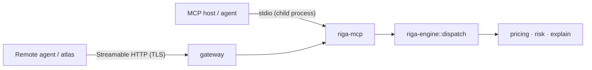

# 30 — MCP Server Design (Agent-Tool-First)

> **Status:** Normative. This is the primary interface of riga-flow.

---

## 1. Why MCP, not REST

riga-flow's primary consumer is an **agent**, so the interface is shaped around agent
mechanics rather than browser mechanics.

| Concern | REST web service | riga-flow MCP server |
| --- | --- | --- |
| Discovery | OpenAPI/out-of-band | `tools/list`, `resources/list`, `prompts/list` |
| Schema | hand-written docs | JSON Schema from Rust types |
| Streaming/progress | ad-hoc SSE/websocket | protocol-level progress + notifications |
| Cancellation | ad-hoc | protocol-level cancellation |
| Long tasks | polling | tasks / progress notifications |
| Composition by model | prompt engineering | typed tools with descriptions |
| Local launch | separate daemon | spawned child process over stdio |
| Remote | reverse proxy + auth | Streamable HTTP with standard request headers |

The deciding factors: **typed schemas the model can call reliably**, **built-in progress and
cancellation**, and **determinism/reproducibility that is part of the schema**.

> "Traditional REST web service" remains possible as a **secondary** adapter, but the
> dispatcher — not the transport — owns the contract (ADR-15, I-L5).

## 2. Protocol revision ("v2")

riga-flow targets the **current stable MCP revision** implemented by the official Rust SDK
`rmcp` (3.x), which implements the **2026-07-28** specification and remains compatible with
**2025-11-25** and earlier negotiated versions.

| Term | Meaning in this repo |
| --- | --- |
| "official mcp lib" | the `rmcp` crate from `modelcontextprotocol/rust-sdk` |
| "v2" | (a) riga-flow's second-generation, MCP-first interface; (b) the current stable MCP revision negotiated by `rmcp` |
| Compatibility | negotiate down to `2025-11-25` for hosts that need it |

Newer-revision behaviours adopted automatically:
- **SEP-2243 request headers** (`Mcp-Method`, `Mcp-Name`, `Mcp-Param-*`) for proxy routing —
  emitted/validated by `rmcp` once negotiated; no call-site changes.
- **Stateless Streamable HTTP**: modern Streamable HTTP uses the POST response stream
  directly (no sessions/GET/DELETE/Last-Event-ID).

## 3. Transports

Both transports are mandatory (AC-M1).

### 3.1 stdio (local, default)

```
MCP host → spawns `riga-mcp` → newline-delimited JSON-RPC over stdin/stdout
```

Use when the engine runs beside the agent/atlas: zero configuration, no ports, process
isolation, easy to sandbox. This mirrors `fina-builder`'s `fina-mcp` stdio sidecar model.

### 3.2 Streamable HTTP (remote / multi-tenant)

- Exposed as a **Tower service** (`StreamableHttpService`) mountable on any router.
- Modern revision is **stateless**; the POST response stream carries notifications/tasks.
- Loopback-only by default (DNS-rebinding protection); public deployments set an explicit
  allowed-host list.
- Optional OAuth 2.0 (`auth` feature) for hosted deployments.



## 4. Capabilities exposed

| Capability | Revision status | Use in riga-flow |
| --- | --- | --- |
| **tools** | core | price, risk, explain, market, cluster, replay, regression, governance |
| **resources** + resource templates | core | `riga://market/{id}`, `riga://book/{id}`, `riga://ledger/{run}`, `riga://path/{run}/{id}`, `riga://fixtures/…` |
| **prompts** | core | `explain_pv_change`, `triage_regression`, `investigate_validation_failure`, `summarise_risk_report`, `recommend_stress_scenarios` |
| progress notifications | core | long pricing/risk runs |
| cancellation | core | abort a run |
| **Tasks extension** (SEP-2663) | 2026-07-28 | materialise long tool calls as tasks; poll `tasks/get`; `tasks/cancel` |
| **subscriptions/listen** | 2026-07-28 | transport-neutral progress/result streaming for a run |
| **elicitation / MRTR** (SEP-2322) | core / 2026-07-28 | confirm bulky requests (e.g. > threshold path counts) |
| **completions** | core | autocomplete market/book ids |
| caching hints (SEP-2549) | 2026-07-28 | cache market/book/ledger reads with TTL |
| sampling | **deprecated** (SEP-2577) | **not used** — riga-flow never calls a model for pricing |
| roots | **deprecated** (SEP-2577) | not used |
| logging | **deprecated** (SEP-2577) | not used; use progress/tasks instead |

> **Hard boundary.** riga-flow never lets a model result influence pricing/risk (AC-M6).
> Because `sampling`, `roots` and `logging` are deprecated in the current revision, riga-flow
> deliberately builds **none** of its behaviour on them: long runs use the **Tasks
> extension**, and streaming uses **subscriptions/listen**.

## 5. Determinism in the schema

Every pricing/risk/explain tool requires:

```json
{
  "seed": 42,
  "as_of": "2026-10-15",
  "market_snapshot_id": "sha256:…",
  "config": { "paths": 100000, "path_block_size": 4096,
              "variance_reduction": { "kind": "sobol" } },
  "trace_level": "aggregated"
}
```

Identical inputs ⇒ byte-identical outputs on every transport (ADR-15, AC-M2). `as_of` is
never read from the clock.

## 6. Long-running operations

100k-trade FD books are long. The server must:

1. accept a run, return a **run id**,
2. emit **progress notifications** (clusters/paths/bumps completed),
3. support **cancellation**,
4. support **resumption** from a persisted run when the transport drops,
5. expose the **ledger** as a resource when complete.

## 7. Error contract

One shape everywhere (matching `fina-builder`):

```json
{ "code": "invalid_barrier", "message": "KI barrier must be < coupon barrier" }
```

Mapped from `riga-core` domain errors; no transport-specific error shapes.

## 8. Security & governance

| Concern | Measure |
| --- | --- |
| Local safety | stdio spawn; no listening socket by default |
| Remote exposure | Streamable HTTP + TLS + allowed-host list + optional OAuth |
| Bulk/destructive runs | elicitation confirmation for > threshold path counts |
| Auditability | every run carries `snapshot_id`, `seed`, `as_of`, code revision |
| Model isolation | numeric path never consumes model output |

## 9. Invariants

- **I-MCP1** Both stdio and Streamable HTTP are always supported.
- **I-MCP2** Adapters contain no domain logic; the dispatcher owns the contract.
- **I-MCP3** Determinism fields are mandatory schema, not optional.
- **I-MCP4** Long runs expose progress + cancellation + resumable runs.
- **I-MCP5** No model output influences pricing/risk.
- **I-MCP6** Tool/resource/prompt surfaces are versioned; changes are additive.
