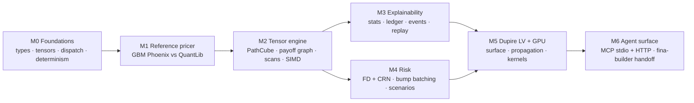

# 20 — Roadmap

> **Status:** Planning. Milestones are ordered by ROI (see [`../architecture/09-performance-targets.md`](../architecture/09-performance-targets.md)).

---

## 1. Milestones



| Milestone | Outcome | Basis |
| --- | --- | --- |
| **M0** | Workspace, core types, tensor layout, deterministic dispatch | build plan Phase 1 |
| **M1** | GBM Phoenix price matches reference within 1 bp | build plan Phase 2 |
| **M2** | Payoff graph + scans + SoA + SIMD running over PathCube | build plan Phases 3, 4, 8 |
| **M3** | Statistics + Explain Ledger + snapshots + replay queryable | explainability gaps |
| **M4** | 61-scenario FD Greeks with CRN, clustered | build plan Phases 5, 7 |
| **M5** | Dupire LV production model, GPU propagation | build plan Phases 6, 9 |
| **M6** | MCP server (stdio + Streamable HTTP); handoff package | ADR-10 |

## 2. Phase sequence (canonical)

The build plan (§21) details each. Ordering honours the ROI ranking (path evolution > layout
> payoff tensorisation > Sobol > GPU > RNG) and the dependency graph above.

| Phase | Name | Depends on | Milestone |
| --- | --- | --- | --- |
| 0 | Foundations & determinism | — | M0 |
| 1 | Core types & tensor layout | 0 | M0 |
| 2 | GBM engine + reference validation | 1 | M1 |
| 3 | Graph execution runtime (places/transitions) | 1 | M2 |
| 4 | Scan primitives (memory coupon) | 3 | M2 |
| 5 | FD Greeks + CRN | 2, 4 | M4 |
| 6 | Dupire Local Vol | 2 | M5 |
| 7 | Clustering runtime + scheduler | 3, 5 | M4 |
| 8 | SIMD kernels | 1, 3 | M2 |
| 9 | GPU path propagation | 6, 7 | M5 |
| 10 | Production risk engine | 5, 7, 9 | M4/M5 |
| 11 | Explainability & ledger | 3, 5 | M3 |
| 12 | MCP server (stdio + Streamable HTTP) | 0, 2 | M6 |
| 13 | fina-builder handoff package | 11, 12 | M6 |

> Phases 11–13 extend the engine phases (0–10, which stop at the production risk engine).
> They are required by riga-flow's goals: the engine must be **explainable** and
> **agent-tool-first**, and the visual atlas is a **handoff**.

## 3. Sequencing rationale

| Decision | Reason |
| --- | --- |
| GBM before LV | validate the whole graph against a reference before adding the LV bottleneck |
| Scans before Greeks | memory coupon must be correct before it is differentiated |
| Clustering before GPU | GPU without clustering "collapses" on divergence |
| SIMD in parallel with graph | layout is the SIMD prerequisite; cheap early wins |
| Explainability before MCP | tools must have something worth exposing |
| MCP last-but-one | the server is thin once the dispatcher exists |
| Handoff after explainability | the atlas needs the ledger/stats contract |

## 4. Deferred / research tracks

| Track | Status |
| --- | --- |
| AAD (adjoint) Greeks | feature-flagged research (ADR-9) |
| Heston / SLV models | later optional tier |
| PCA factor compression | when factor count dominates memory |
| Scenario recommendation | M4/M3 combination |
| Governance report generation | M6, content only |

## 5. Definition of done (summary)

A complete riga-flow can run:

```
Cluster → Scenario Batch → Path Block → Tensor Graph → Greeks
```

with **no trade-level simulation loops** in the top-level flow, Docker-free, driven entirely
through MCP — and answer "why did this trade's PV change?" from the ledger. Full criteria in
[`22-acceptance-criteria.md`](22-acceptance-criteria.md).
